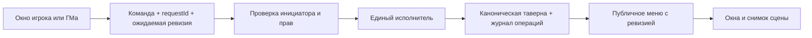

# Независимый аудит FBL Tavern Generator

> После аудита внесены исправления локальной версии 0.7.16. Их состав, проверки и оставшиеся ограничения описаны в [CHANGELOG_0.7.16.md](CHANGELOG_0.7.16.md). Ниже сохранено исходное ревью состояния до исправлений.

Дата: **13 октября 2026 года**. Целевая платформа: **Foundry VTT v13**.

## Вывод

Модуль уже полезен как инструмент подготовки и проведения игры: региональные меню, запасы, кошелёк, ночлег, сцены и «Жизнь таверны» образуют связный сценарий. Сильнее всего здесь контент и сокращение ручной работы ГМа. Главная слабость — согласованность состояния при покупках, редактировании, повторной доставке сообщений и смене дня.

**Следующий этап я посвятил бы надёжности существующих функций.** В проверках обнаружились возможность подмены отправителя в локальной версии, восстановление скрытого сгенерированного контента, повторное списание после перезапуска обработчика и потеря данных при конкурирующих операциях. Это конкретные дефекты, а не пожелания к стилю кода.

Для развития наиболее полезны: безопасная история покупок и возвраты, полноценные брони, групповые заказы, сохранение сюжетного состояния таверны, содержательные услуги и удобная библиотека заведений. Ещё несколько сотен случайных блюд дадут меньший эффект.

## 1. Что именно проверено

### Две разные версии

| Объект | Версия и источник | Значение для аудита |
|---|---|---|
| Установленный модуль | **0.7.15**, локальная папка проекта | Основной объект проверки текущего поведения |
| GitHub, ветка main | **0.7.7**, commit `10826568dcd630ef7eb96289e9bc778fbbb4de87` | Отдельно проверенная опубликованная версия |
| README локальной копии | Указывает **0.7.12** | Уже не соответствует установленному коду |

[Зафиксированная версия GitHub](https://github.com/Mishokkka/tavern-generator/tree/10826568dcd630ef7eb96289e9bc778fbbb4de87). В локальной папке нет каталога Git, поэтому её нельзя считать checkout этого коммита.

Сверены все 115 файлов GitHub с локальной копией с нормализацией переводов строк. 102 совпадают; 12 имеют отличающееся содержимое, один файл есть только на GitHub. Локально дополнительно присутствует `TavernSocketRelay.js`. Основные различия — транспорт, интерфейс игрока, сцены, интеграция чистоты, документация и тесты.

В отчёте **«обе версии»** означает наличие проблемы в 0.7.7 и 0.7.15. Ссылки на код относятся к отдельному коммиту установленной версии 0.7.15 до исправлений; номера строк зафиксированы на дату аудита.

### Метод и границы

Проверены архитектура и зависимости, запуск, права, сетевые маршруты, покупки и откат, хранение и миграции, генерация, цены, доступность, бронирования, смена дня, интеграции, шаблоны, CSS, API и выпуск модуля. Контент проверен валидатором, генерацией по полной матрице параметров и выборочным редакторским разбором.

Выполнены штатные тесты и отдельные воспроизведения проблем с подставными документами Foundry. Игровые данные, кошельки реальных персонажей и настройки мира не менялись. Исходный код модуля не исправлялся.

**Живой многоклиентский тест Foundry и визуальный прогон интерфейса не выполнялись:** в доступных браузерных поверхностях не было открытой сессии Foundry. Поэтому выводы об интерфейсе основаны на шаблонах, стилях и обработчиках, а не на субъективном впечатлении от скриншотов. Проверки Node.js не подтверждают работу Canvas, реальных прав JournalEntry, браузерных диалогов и всех сочетаний сторонних модулей.

### Проверки и результаты

| Проверка | Результат |
|---|---|
| Локальный `npm run check` | Пройден: 101 JS/MJS-файл, ссылки manifest, баланс блоков Handlebars |
| Локальные штатные тесты | **35/35** |
| Тесты GitHub 0.7.7 | **32/32** |
| Проверка контента | **0 ошибок, 0 предупреждений** |
| Полная матрица генерации | **2016** сочетаний: 18 регионов × 4 качества × 4 размера × 7 местностей |
| Дополнительные проверки | Подмена отправителя, восстановление секретов, конфликт записей, повтор оплаты, цены, календарь, сезонность, брони, смена таверны, масштабирование |

Среда: Node.js **24.16.0**. Обычный `npm run verify` прошёл статическую часть, но запуск изолированного test runner завершился `spawn EPERM` из-за ограничений среды. Те же тесты успешно выполнены командой `node --test --test-isolation=none tests/core.test.mjs`. Это ограничение окружения аудита, не дефект модуля.

## 2. Что уже сделано хорошо

- **Разделение ответственности.** Генерация, цены, хранилище, покупки, доступность и интеграции вынесены из окон в отдельные сервисы. Это хорошая основа для доработок без полной переписки.
- **Покупки пересчитываются на стороне ГМа.** Клиент не определяет цену; проверяются владелец Actor, остатки, категории, число строк и количество. Это правильная модель доверия, хотя транспорт в 0.7.15 её подрывает.
- **Есть компенсационный откат.** При ошибке записи таверны модуль пытается восстановить и кошелёк, и состояние. Ошибки чата и звука после оплаты не отменяют покупку.
- **Учтены сложные случаи интерфейса.** Сохраняется незавершённая оплата при закрытии окна, используются повторные requestId, можно выбрать плательщика, искать меню и закреплять контент.
- **Предусмотрены миграции и разделение публичного/закрытого состояния.** Сценовые снимки не используются напрямую как доверенный источник цены при покупке.
- **Хорошая предметная база.** 297 блюд, 139 напитков, 14 вариантов ночлега, 28 услуг, 18 состояний обстановки, 60 слухов, 45 завсегдатаев и 45 происшествий.
- **Интерфейс соответствует направлению v13.** Используются ApplicationV2 и HandlebarsApplicationMixin, есть контейнерные правила адаптации, часть ARIA-разметки и клавиатурная навигация вкладок.
- **Продуманы необязательные интеграции.** Есть резервный кошелёк, несколько путей применения чистоты, фильтрация флагов неактивных модулей, восстановление блокировки compendium.

Тесты действительно проверяют полезные инварианты. Но зелёный набор сейчас означает прежде всего правильность отдельных операций в управляемом окружении, а не надёжность многопользовательской системы.

## 3. Реестр проблем

Приоритет **P1**: исправить до расширения автоматизации и широкого распространения; возможны несанкционированные действия, потеря данных или неверная оплата. **P2**: исправить в ближайшем цикле; нарушается заявленная механика или обычный сценарий. Это продуктовые приоритеты, не оценка CVSS.

| ID | Приоритет | Проблема | Версии | Доказательство |
|---|---|---|---|---|
| F01 | P1 | Socket доверяет заявленному отправителю | 0.7.15 | Воспроизведено списание с чужого Actor |
| F02 | P1 | Секретная атмосфера восстанавливается из публичных данных | Обе | Воспроизведено точное восстановление |
| F03 | P1 | Игрок выбирает импортируемый ГМом compendium-документ | Обе | Воспроизведено в 0.7.15; путь есть в 0.7.7 |
| F04 | P1 | Конкурирующие изменения перезаписывают друг друга | Обе | Воспроизведены потеря сохранения и правки |
| F05 | P1 | Защита от повторной оплаты не переживает смену обработчика | Обе | Воспроизведено в 0.7.15; одинаковый принцип кэша |
| F06 | P1 | Списание не совпадает с ценой в корзине | Обе | Показано 5 ММ, списано 50 ММ |
| F07 | P2 | Календарный скачок обрабатывается как один день | Обе | После 5 дней бронь уменьшилась на 1 |
| F08 | P2 | Генератор удаляет сезонность из позиций | Обе | 1249 выбранных сезонных позиций, 0 сохранённых полей |
| F09 | P2 | Адаптер не читает API установленной Calendaria 1.0.11 | Обе | Проверены исходник зависимости и форма её payload |
| F10 | P2 | Новый день нарушает нулевой maxStock | Обе | 0/0 превращается в 1/1 |
| F11 | P2 | Редактирование мест позволяет нарушить существующие брони | Обе | 2 брони при вместимости 1 |
| F12 | P2 | Корзина не привязана к конкретной таверне | Обе | Позиция старой таверны остаётся после переключения |
| F13 | P2 | Названия не согласуются по роду и падежу | Обе | Получены грамматически неверные названия |

### F01. Подмена пользователя в сетевом транспорте

Источник: [scripts/services/TavernSocketRelay.js](https://github.com/Mishokkka/tavern-generator/blob/5a987ce649c1fca34609e9005d197fa2cb0958f1/scripts/services/TavernSocketRelay.js#L77), [scripts/services/TavernSocket.js](https://github.com/Mishokkka/tavern-generator/blob/5a987ce649c1fca34609e9005d197fa2cb0958f1/scripts/services/TavernSocket.js#L203), [scripts/services/TavernPurchaseService.js](https://github.com/Mishokkka/tavern-generator/blob/5a987ce649c1fca34609e9005d197fa2cb0958f1/scripts/services/TavernPurchaseService.js#L45).

Relay получает `senderId` из присланного envelope, находит такой User и использует его как фактического отправителя. Проверка `payload.sender === sender.id` ничего не доказывает: relay сам присваивает это значение из того же envelope. Наличие активного пользователя в мире подтверждает его существование, но не авторство сообщения.

В изолированном воспроизведении подан envelope с чужим `senderId`; Actor разрешал OWNER только этому чужому пользователю. Через настоящий обработчик покупки кошелёк уменьшился **100 → 95**, запас **20 → 19**.

Возможные последствия: покупка от чужого имени, ложные результаты оплаты и сообщения обновления от имени ГМа. Для эксплуатации нужен подключённый пользователь, способный отправить произвольный пакет модуля. Это не утверждение об удалённом доступе к серверу извне.

**Исправление:** связать личность с проверяемым транспортным контекстом, а не с полем JSON. Рассмотреть штатный `User.query`/зарегистрированные queries v13, предварительно проверив способ получения фактического инициатора на целевой сборке. Сам по себе переход на другую библиотеку сокетов не заменяет проверку авторства. [Документация User.query](https://foundryvtt.com/api/v13/classes/foundry.documents.User.html#query).

**Критерий:** клиент A не может инициировать покупку от B или доставить принимаемый результат от GM даже при полном ручном формировании envelope.

В GitHub 0.7.7 используется `TavernSocketIdentity` с подписью ECDSA. Этот конкретный обход нельзя автоматически приписывать 0.7.7. Но там другая эксплуатационная проблема: зависимость от `crypto.subtle` блокирует транспорт в обычном небезопасном LAN HTTP-контексте. Требование secure context описано в [MDN](https://developer.mozilla.org/en-US/docs/Web/API/Crypto/subtle). Локальная замена решила зависимость от Web Crypto ценой утраты проверки отправителя.

### F02. Удаление atmosphere не скрывает сгенерированные секреты

Источник: [scripts/services/TavernAtmosphereService.js](https://github.com/Mishokkka/tavern-generator/blob/5a987ce649c1fca34609e9005d197fa2cb0958f1/scripts/services/TavernAtmosphereService.js#L107) и [scripts/services/TavernAtmosphereService.js](https://github.com/Mishokkka/tavern-generator/blob/5a987ce649c1fca34609e9005d197fa2cb0958f1/scripts/services/TavernAtmosphereService.js#L240).

Атмосфера детерминированно вычисляется из публичного `tavern.id`, номера revision и известной строки salt. Таблицы с секретами загружаются в клиентский модуль, а `publicView` отдельно передаёт `publicAvailability.atmosphereRevision`.

Для свежей таверны достаточно взять публичное представление, добавить `atmosphere: { revision: publicAvailability.atmosphereRevision }` и вызвать `ensure`. В проверке **полностью совпали слухи, завсегдатаи и происшествие, включая скрытые поля**.

Это гарантированное воспроизведение для исходной генерации; ручные изменения и сложная история закреплений могут уже не восстановиться одним вызовом. Но обещание скрытой «Жизни таверны» нарушено уже в основном сценарии.

**Исправление:** независимый случайный seed для закрытого контента, сохранённый только в реально закрытом хранилище. Публичный seed можно оставить для названия и меню. Использовать явный список разрешённых полей публичного DTO. Проверить на реальном player-клиенте, что закрытый seed и данные JournalEntry не доступны через синхронизированные документы.

**Критерий:** из всех данных обычного игрока нельзя получить выбранную правду слухов и секреты NPC без раскрытия ГМом.

### F03. Произвольный импорт сцены через запрос игрока

Источник: [scripts/services/TavernSceneService.js](https://github.com/Mishokkka/tavern-generator/blob/5a987ce649c1fca34609e9005d197fa2cb0958f1/scripts/services/TavernSceneService.js#L776), [scripts/services/TavernSceneService.js](https://github.com/Mishokkka/tavern-generator/blob/5a987ce649c1fca34609e9005d197fa2cb0958f1/scripts/services/TavernSceneService.js#L942).

После нахождения доверенной таверны метод разрешения сцены берёт `link.compendium` раньше приватной связи таверны. Этот link приходит от игрока. При отсутствии подходящей мировой сцены ГМ читает указанный pack/document и импортирует его без проверки соответствия исходной таверне и права инициатора.

В проверке обычный пользователь, указав ID существующей таверны, заставил маршрут вызвать импорт **другого документа** из подставного закрытого compendium. Изоляция подтверждает обход проверок модуля; поведение реального pack и его содержимого требует многоклиентского теста.

**Исправление:** клиент передаёт только ID разрешённой таверны/связи; pack, UUID и sceneId выбираются из доверенной записи. Проверять тип документа, принадлежность таверне и доступ игрока. Импорт и восстановление библиотеки лучше оставлять явным действием ГМа.

**Критерий:** подстановка другого pack/id отклоняется до чтения и создания документа.

### F04. Нет единой последовательности изменений состояния

Источник: [scripts/services/TavernPrivateStore.js](https://github.com/Mishokkka/tavern-generator/blob/5a987ce649c1fca34609e9005d197fa2cb0958f1/scripts/services/TavernPrivateStore.js#L65), [scripts/services/TavernState.js](https://github.com/Mishokkka/tavern-generator/blob/5a987ce649c1fca34609e9005d197fa2cb0958f1/scripts/services/TavernState.js#L113), [scripts/services/TavernPurchaseService.js](https://github.com/Mishokkka/tavern-generator/blob/5a987ce649c1fca34609e9005d197fa2cb0958f1/scripts/services/TavernPurchaseService.js#L42), [scripts/apps/TavernGMApp.js](https://github.com/Mishokkka/tavern-generator/blob/5a987ce649c1fca34609e9005d197fa2cb0958f1/scripts/apps/TavernGMApp.js#L688).

`AsyncLock` сериализует только покупки и только внутри одного JS-клиента. Сохранения, новый день, правки ГМа и восстановление состояния идут отдельно. Каждая операция читает снимок и записывает весь объект `{current, saved}`.

Два воспроизведения в обеих версиях:

1. Два параллельных `saveTavern` для разных таверн: обе операции завершились успешно, в библиотеке осталась **одна**.
2. Покупка остановлена на записи кошелька; ГМ меняет название; покупка продолжена. Деньги списаны, название заменено старым снимком.

Есть связанный риск Undo: [scripts/apps/TavernGMApp.js](https://github.com/Mishokkka/tavern-generator/blob/5a987ce649c1fca34609e9005d197fa2cb0958f1/scripts/apps/TavernGMApp.js#L596) восстанавливает весь `undoDraft`, включая запасы и брони. Покупка между checkpoint и Undo может исчезнуть из таверны без возврата денег. Это вывод из пути кода; отдельного браузерного воспроизведения Undo не было.

**Исправление:** все команды изменения проводить через одного выбранного исполнителя; хранить ревизию и проверять ожидаемую ревизию перед применением. На одном клиенте использовать общую очередь для записей хранилища. Для нескольких клиентов нужна координация исполнителя, а не ещё один локальный mutex. Undo должен отменять конкретную редакторскую команду, не историю торговли.

Дополнительно: `advanceDay` предпочитает сохранённую копию активной таверны без сравнения ревизий. Две полные копии одного заведения — источник неоднозначности даже без одновременного исполнения.

### F05. «Без повторного списания» действует только пока жив кэш

Источник: [scripts/services/TavernSocket.js](https://github.com/Mishokkka/tavern-generator/blob/5a987ce649c1fca34609e9005d197fa2cb0958f1/scripts/services/TavernSocket.js#L17), [scripts/services/TavernSocket.js](https://github.com/Mishokkka/tavern-generator/blob/5a987ce649c1fca34609e9005d197fa2cb0958f1/scripts/services/TavernSocket.js#L403), [scripts/apps/TavernPlayerApp.js](https://github.com/Mishokkka/tavern-generator/blob/5a987ce649c1fca34609e9005d197fa2cb0958f1/scripts/apps/TavernPlayerApp.js#L584).

Результаты requestId хранятся в памяти выбранного ГМа на 30 минут. После перезагрузки вкладки, переключения ответственного ГМа или истечения TTL история теряется. Автоповтор игрока выбирает текущего ответственного ГМа заново.

Проверка локальной версии: первая оплата **100 → 95**; повтор с тем же requestId в том же обработчике — **95**; новая инстанция обработчика и тот же requestId — **90**.

Также выбор одного GM **User** не различает две вкладки под одним GM-аккаунтом. У каждой свои lock и кэш, а обе считают себя ответственными.

**Исправление:** долговечный журнал операций с requestId, пользователем, составом запроса, статусом и результатом. Для незавершённых операций — восстановление и сверка кошелька/запасов. Запись статуса после успеха сама по себе не закрывает окно аварии между списанием и фиксацией; нужна продуманная процедура восстановления.

**Критерий:** потеря ответа, перезапуск, смена ГМа и повтор в другой вкладке не создают вторую покупку. Сообщение после тайм-аута должно говорить «результат пока неизвестен», поскольку «покупка не обработана» сейчас может быть неправдой.

### F06. Пользователь подтверждает одну цену, платит другую

Источник: [scripts/apps/TavernPlayerApp.js](https://github.com/Mishokkka/tavern-generator/blob/5a987ce649c1fca34609e9005d197fa2cb0958f1/scripts/apps/TavernPlayerApp.js#L300), [scripts/apps/TavernPlayerApp.js](https://github.com/Mishokkka/tavern-generator/blob/5a987ce649c1fca34609e9005d197fa2cb0958f1/scripts/apps/TavernPlayerApp.js#L482), [scripts/services/TavernPurchaseService.js](https://github.com/Mishokkka/tavern-generator/blob/5a987ce649c1fca34609e9005d197fa2cb0958f1/scripts/services/TavernPurchaseService.js#L63).

Корзина хранит цену на момент добавления. Обновление таверны не пересчитывает её строки. ГМ при оплате использует текущую цену и не сравнивает её с подтверждённой суммой.

В проверке товар добавлен за **5 ММ**, затем цена изменена на **50 ММ**, доставлено обновление меню. Корзина продолжила показывать **5 ММ**, сервис списал **50 ММ**. Аналогично устаревают пределы количества и удалённые позиции.

**Исправление:** quote/revision или ожидаемая итоговая сумма. Сервер всё равно рассчитывает цену самостоятельно; расхождение должно вернуть новую котировку для подтверждения. Обновления меню отмечают изменённые/недоступные строки.

**Критерий:** повышенная цена никогда не списывается незаметно для плательщика.

### F07. Новый календарный ключ не означает один прошедший день

Источник: [scripts/services/TavernDailyService.js](https://github.com/Mishokkka/tavern-generator/blob/5a987ce649c1fca34609e9005d197fa2cb0958f1/scripts/services/TavernDailyService.js#L55), [scripts/services/TavernDailyService.js](https://github.com/Mishokkka/tavern-generator/blob/5a987ce649c1fca34609e9005d197fa2cb0958f1/scripts/services/TavernDailyService.js#L69), [scripts/services/TavernState.js](https://github.com/Mishokkka/tavern-generator/blob/5a987ce649c1fca34609e9005d197fa2cb0958f1/scripts/services/TavernState.js#L344).

Код сравнивает ключи дат и однократно уменьшает `remainingDays`. При переходе на пять дней вперёд пятидневная бронь остаётся на **четыре дня**. Перевод времени назад также воспринимается как новый день. Внутри `refreshTavernForNewDay` нет проверки уже обработанного `lastDayKey`; глобальная отметка сохраняется только после всех изменений.

**Исправление:** даты начала/окончания брони и последний обработанный абсолютный день каждой таверны. Отдельно определить правила пропуска дней, отката времени, первого запуска и ручной кнопки. Для большого скачка рассчитывать итоговое состояние ограниченным числом операций.

**Критерий:** +5 дней завершает пятидневную бронь; повторное событие не повторяет обновление; откат времени не пополняет товары.

### F08. Сезонные данные теряются при генерации

Источник: [scripts/services/TavernInventory.js](https://github.com/Mishokkka/tavern-generator/blob/5a987ce649c1fca34609e9005d197fa2cb0958f1/scripts/services/TavernInventory.js#L195), [scripts/services/TavernPricing.js](https://github.com/Mishokkka/tavern-generator/blob/5a987ce649c1fca34609e9005d197fa2cb0958f1/scripts/services/TavernPricing.js#L60).

В исходных таблицах есть пять позиций с `seasonal`. Метод `#pricedEntry` собирает новый объект по списку полей и не переносит сезонность. Формула цены существует, но у сгенерированной позиции нет данных для её работы.

В фиксированном прогоне 2016 таверн сезонные позиции выбраны **1249 раз**, поле сохранилось **0 раз**. Это наблюдение выполнено на обеих версиях.

**Исправление:** переносить поддерживаемые механические поля через единую схему; хранить ID исходной записи. Добавить тест полного пути «таблица → генерация → сезон → отображение → покупка».

### F09. Calendaria: угадывание API вместо контракта

Источник: [scripts/services/CalendariaAdapter.js](https://github.com/Mishokkka/tavern-generator/blob/5a987ce649c1fca34609e9005d197fa2cb0958f1/scripts/services/CalendariaAdapter.js#L82), [scripts/services/CalendariaAdapter.js](https://github.com/Mishokkka/tavern-generator/blob/5a987ce649c1fca34609e9005d197fa2cb0958f1/scripts/services/CalendariaAdapter.js#L105). Сопоставлено с установленной Calendaria 1.0.11 и её кодом (`calendaria.mjs`, зависимость установлена локально).

У зависимости API находится в `globalThis.CALENDARIA.api`, методы — `getCurrentDateTime()` и `getCurrentSeason()`. Адаптер ищет `game.calendaria` и `globalThis.Calendaria`, а также иные имена методов. Событие `calendaria.dayChange` действительно совпадает, но передаёт `{previous, current, calendar}`; адаптер не разворачивает `current`.

Результат воспроизведения: при существующем API и дате календаря возвращается `world:2`, сезон — `null`. Поэтому нельзя сказать, что интеграция полностью выключена: дневной hook может обновлять таверну по резервному `worldTime / 86400`. Но сезонность и календари с иной длиной дня работают неверно или теряются.

**Исправление:** поддержать конкретную документированную форму API и событий, вынести длину дня из жёсткой константы и показывать реально выбранный источник времени.

### F10. Нулевой лимит запасов самопроизвольно увеличивается

Источник: [scripts/services/TavernDailyService.js](https://github.com/Mishokkka/tavern-generator/blob/5a987ce649c1fca34609e9005d197fa2cb0958f1/scripts/services/TavernDailyService.js#L157).

`Math.max(1, rawMax)` превращает допустимый `maxStock: 0` в 1. При включённом пополнении позиция `stock: 0, maxStock: 0` становится `1/1`. Существующий тест проверяет сохранение нуля миграцией, но не обновлением дня.

**Исправление:** разрешить нулевую ёмкость и проверять `0 ≤ stock ≤ maxStock` после всех операций. Отдельно дать ГМу поле штатного максимума: сейчас редактор обычной позиции не позволяет явно уменьшать maxStock, поэтому уменьшение текущего запаса не означает уменьшения следующего пополнения.

### F11. Вместимость комнаты не защищена активными бронями

Источник: [scripts/services/TavernEditor.js](https://github.com/Mishokkka/tavern-generator/blob/5a987ce649c1fca34609e9005d197fa2cb0958f1/scripts/services/TavernEditor.js#L100), [scripts/services/TavernEditor.js](https://github.com/Mishokkka/tavern-generator/blob/5a987ce649c1fca34609e9005d197fa2cb0958f1/scripts/services/TavernEditor.js#L7), [scripts/services/TavernState.js](https://github.com/Mishokkka/tavern-generator/blob/5a987ce649c1fca34609e9005d197fa2cb0958f1/scripts/services/TavernState.js#L293).

Редактор меняет свободные места без учёта действующих броней. Сценарий: вместимость 1 → бронь на 3 дня → ГМ выставляет свободно 1 → вторая покупка. Итог: **две оплаченные брони при вместимости один**. Удаление варианта ночлега также не обрабатывает связанные брони.

**Исправление:** свободные места вычислять из вместимости, постояльцев-NPC и активных броней. При конфликтующей правке показать, кого она затронет, и предложить перенос/отмену с понятной политикой возврата.

### F12. Смена таверны оставляет чужую корзину

Источник: [scripts/apps/TavernPlayerApp.js](https://github.com/Mishokkka/tavern-generator/blob/5a987ce649c1fca34609e9005d197fa2cb0958f1/scripts/apps/TavernPlayerApp.js#L118), [scripts/apps/TavernPlayerApp.js](https://github.com/Mishokkka/tavern-generator/blob/5a987ce649c1fca34609e9005d197fa2cb0958f1/scripts/apps/TavernPlayerApp.js#L354).

`setTavern` меняет только отображаемую таверну. Корзина и её ключи не включают tavernId. После переключения остаются старые строки, а новая оплата использует ID новой таверны. Обычно это заканчивается ошибкой «позиция не найдена».

Незавершённая оплата хранит правильный tavernId в snapshot — это полезная защита, которую нужно сохранить.

**Исправление:** корзины по tavernId либо явное предложение очистить/сохранить корзину при смене заведения. У открытого меню должен быть явный режим: «следовать активной таверне» или «это конкретное заведение».

### F13. Морфология названий требует структуры

Источник: [scripts/services/TavernNames.js](https://github.com/Mishokkka/tavern-generator/blob/5a987ce649c1fca34609e9005d197fa2cb0958f1/scripts/services/TavernNames.js#L4), [scripts/data/names/regions/common.js](https://github.com/Mishokkka/tavern-generator/blob/5a987ce649c1fca34609e9005d197fa2cb0958f1/scripts/data/names/regions/common.js#L4).

Прилагательные заданы в одной форме, существительные — преимущественно в родительном падеже, слова местности подмешиваются в общий пул. Шаблоны требуют разных форм. Контролируемые вызовы генератора дали **«У черного версты»** и **«ворона у дороги»**.

**Исправление:** словарь с родом и формами либо готовые согласованные пары. Для небольшого модуля тщательно подобранные шаблоны проще и надёжнее полноценного морфологического движка. Готовые названия уже есть, но выбираются только примерно в 25% случаев.


## 4. Архитектура, хранение и восстановление

### Один объект таверны должен иметь один источник истины

Сейчас существуют черновик GM-окна, полная current-таверна, полная saved-таверна, публичная world-setting, публичные флаги сцены, сценовый архив и override окна игрока. Эти представления имеют разные правила обновления.

Я бы оставил **одну каноническую запись по tavernId**, отдельно сохранил `activeTavernId`, а черновик сделал явной редакторской сессией с исходной ревизией. Публичное меню и сцена были бы производными представлениями с номером версии. Для публикации — явная команда, для покупок — изменение оперативного состояния.

Не обязательно сразу заводить внешний сервер или базу данных. Для небольшого мира достаточно аккуратного репозитория поверх документов Foundry, общего обработчика команд и журнала операций. По мере роста можно разнести таверны по документам; важнее сначала убрать дублирующуюся полную current-копию и бесконтрольные записи.

Предлагаемый поток:



Это схема границ ответственности. Она не подразумевает, что несколько отдельных документов Foundry автоматически образуют атомарную транзакцию.

### Закрытое хранилище и резервные копии

Скрытая JournalEntry предпочтительнее хранения всей атмосферы в публичных world-settings, но сейчас она остаётся единственной точкой хранения библиотеки. При удалении запись пересоздаётся, данные не восстанавливаются. На практике нужны:

- экспорт/импорт выбранной таверны и всей библиотеки в JSON с версией схемы;
- проверка файла перед импортом, режимы «новая копия» и «обновить существующую»;
- резервный снимок перед миграцией и массовым обновлением;
- экран диагностики: ID хранилища, число таверн, последняя успешная запись, проблемы связей;
- мягкое удаление или корзина для таверн.

Сценовый архив **не является полноценной резервной копией таверны**: там публичный снимок, нет прежних секретов, и он может быть старее состояния торговли. В 0.7.15 восстановление из сцены заново строит атмосферу через `ensure`. Это полезное аварийное восстановление оболочки, но интерфейс должен сообщать о потерях и не представлять его как восстановление исходного состояния.

Проверка реальной закрытости JournalEntry на player-клиенте остаётся обязательной: unit-тест проверяет выставление ownership, а не то, какие поля сервер доставляет этому клиенту.

### Миграции

[scripts/services/TavernMigrations.js](https://github.com/Mishokkka/tavern-generator/blob/5a987ce649c1fca34609e9005d197fa2cb0958f1/scripts/services/TavernMigrations.js#L6) одновременно мигрирует, нормализует и глубоко копирует данные практически при каждом чтении. Также в конце принудительно ставится версия 4, даже если входная версия новее.

Я бы разделил:

1. миграцию сохранённого документа при загрузке;
2. валидацию входных команд;
3. построение view model без изменения схемы.

Документ из будущей версии нужно отклонять или открывать только для чтения с предупреждением, а не молча понижать его schemaVersion. Валидация сохранённых таверн должна проверять конечность цен, уникальность ID, согласованность комнат/броней и разумные размеры массивов.

### Что ещё требует осторожности

- `publicView` удаляет atmosphere, но сохраняет остальные поля целиком, включая bookings и метаданные. Нужен явный договор о том, что игроку допустимо видеть; будущий `gmNotes` легко случайно уйдёт в публичную копию.
- Все ГМы выполняют инициализационные записи и очистку legacy-данных. Такие действия лучше поручить одному исполнителю.
- Нет ревизионной защиты от запоздавшего refresh: старый ответ с валидным requestId может вернуть клиенту устаревший снимок.
- Создание сцены/Actor и архивирование — цепочка отдельных операций. Если архив падает после создания, объект уже существует, а UI может сообщить общий неуспех и позволить создать дубль. Нужны отдельные статусы «создано», «не удалось архивировать», «повторить архивирование».
- Функции публичного API не полностью повторяют UI-сценарии: например, `clear()` вызывает очистку состояния без `refreshAll()`, который есть у кнопки окна. Контракт API и уведомлений стоит унифицировать.

Последние пункты — риски и выводы из структуры кода; их не следует считать уже выполненными многоклиентскими воспроизведениями.

## 5. Механики и качество генерации

### Региональность

Региональные таблицы — одна из лучших частей проекта, но выбор региона не гарантирует заметного местного характера. В фиксированном прогоне **470 из 1792** таверн регионов, кроме common и импортного izuaver, не получили ни одной позиции с `local: true`. Это около **26%** в этой выборке, а не оценка точной вероятности для любой кампании.

Такое поведение соответствует случайной ветке генератора; оно не является ошибкой само по себе. Но пользователь, явно выбравший регион, обычно ожидает увидеть его особенности.

Я бы добавил настройку «обязательная местная специализация»: минимум одно характерное блюдо или напиток при наличии подходящих кандидатов. Остальные позиции могут оставаться случайными. Для маленькой таверны особенно полезна одна узнаваемая специализация.

### Доступность и заполненность

В том же прогоне у **9 из 2016** таверн все блюда и напитки оказались недоступны после расчёта crowd-ограничений, хотя генерация создала меню. Причина понятна: резерв округляется вверх, и единичный запас может полностью уйти посетителям.

Нужно выбрать желаемую игровую семантику:

- если «всё раскуплено» — намеренное событие, показывать причину и возможность ожидания;
- если генератор должен всегда выдавать пригодную для обслуживания таверну, гарантировать хотя бы одну доступную базовую позицию;
- разделить реальный товарный запас и загруженность персонала: очередь на баню не обязана закрывать продажу хлеба;
- объяснять игроку, когда вернётся доступность.

Сейчас `availabilityNote` рассчитывается, но карточки игрока не выводят его непосредственно: всплывающая подсказка занята описанием позиции. Числовое ограничение есть, понятного объяснения часто нет.

### Цены

Цены используют качество, местность, регион и общий множитель. Это достаточная модель для игрового инструмента; полноценная экономическая симуляция пока не нужна.

Полезнее сделать цены прозрачнее для ГМа: показывать исходную стоимость и применённые коэффициенты, разрешить персональное исключение для позиции и явно отличать цену места от цены комнаты. Бесплатные позиции сейчас невозможны: несколько слоёв принудительно задают минимум 1 ММ. Если нужны бесплатная вода, оплаченный завтрак или подарок хозяина, потребуется осознанная поддержка нулевой цены.

Баланс относительно официальных таблиц Forbidden Lands в этом аудите **не сертифицирован**. Данные явно ориентированы на конкретную кампанию; численные цены следует согласовывать с её экономикой, а не выдавать их за проверенные правила системы.

### Ночлег

Уже есть места и оплаченные дни, но нет полноценного управления проживанием. Нужны различия между:

- местом в общем зале, койкой и отдельной комнатой;
- плательщиком и гостями;
- временем заезда и окончанием брони;
- бронью, заселением, отменой и завершённым проживанием.

Для ГМа наиболее полезна компактная таблица «кто, где, до какого дня», а для игрока — видимый остаток оплаченных ночей. Сейчас реальные bookings хранятся, но пользовательский сценарий в основном заканчивается сообщением в чат.

### Услуги и результаты покупок

Еда и напитки сейчас уменьшают запас и деньги; предмет или ресурс персонажу автоматически не выдаётся. Из автоматических последствий отдельно реализована чистота. Это допустимый режим «съесть на месте», но его надо назвать явно.

Нужны разные типы исполнения:

- «получено/употреблено сразу»;
- «выдать предмет с собой»;
- «услуга занимает время»;
- «ночлег создаёт бронь»;
- «требуется решение ГМа».

Для еды с собой лучше дать необязательное соответствие Item UUID и количество порций/ресурса через адаптер Forbidden Lands. Не каждое описательное блюдо обязано превращаться в отдельный Item.

Для чистоты стоит заранее показывать, сработает ли интеграция, и не заставлять игрока узнавать после списания, что Quick Access выключен или эффект не найден. При этом услуга может оставаться доступной как сюжетная — если ГМ выбрал такой режим.

### «Жизнь таверны»

Слухи, посетители и происшествия уже дают больше игрового материала, чем обычный генератор меню. Следующий шаг — **память**, а не просто больше случайных строк:

- слух уже рассказан, проверен, опровергнут или связан с заданием;
- NPC знаком с героями, обещал помощь, обиделся или ждёт оплаты;
- происшествие началось, получило последствия или завершилось;
- важное изменение переживает смену дня.

Закрепление частично решает сохранность, но не отражает смысл происходящего. Полная перегенерация атмосферы сейчас сбрасывает и закрепления; это действие стоит назвать более явно и показать предупреждение о затрагиваемых записях.

## 6. Удобство использования

Это разбор сценариев и реализации. Отдельные выводы о размерах/фокусе следует подтвердить в живом Foundry.

### Первый запуск

Открытие через консоль и самостоятельно созданный макрос — высокий порог для модуля, который экономит подготовку. Я бы добавил кнопку в подходящую панель Foundry и команду горячей клавиши, а макросы поставлял готовыми.

Первый запуск должен показывать два действия: **«Создать таверну»** и **«Открыть библиотеку»**. Дополнительно — короткий статус интеграций. Создание меню должно работать без настройки файловой структуры артов, Character Forge и Calendaria.

Локальный путь фонов `3_F00L/Scenes/Interior/Taverns` удобен в авторской установке, но для нового пользователя это чужая структура. Нужен мастер выбора каталога или понятное предложение создать сцену без готового фонового набора.

### Черновик, публикация и сохранение

Сейчас пользователь должен различать «Подтвердить», «Сохранить» и «Открыть игрокам», а правки уже сохранённой таверны могут немедленно записываться через `#persistLiveDraft`. Термин «черновик» поэтому не всегда совпадает с поведением.

Предлагаемые видимые состояния:

| Состояние | Что означает | Основное действие |
|---|---|---|
| Новый черновик | Ещё не попал в библиотеку и игрокам | Сохранить |
| Сохранена | Есть в библиотеке | Открыть игрокам |
| Открыта игрокам | Игроки видят опубликованную ревизию | Обновить меню |
| Есть правки | Редактор отличается от опубликованного меню | Опубликовать изменения |

Вариант с немедленным применением также возможен, но тогда нужен постоянный индикатор «изменения применяются сразу». Главная цель — предсказуемость, а не обязательное увеличение числа кнопок.

### Основное окно ГМа

Сцены, шаблоны, архив и тавернщик занимают значительную часть формы перед меню. Я бы вынес их в сворачиваемый раздел «Оформление и сцена», а приоритет отдал самой таверне.

Основные действия лучше подписать словами. ARIA-метки полезны, но не заменяют видимую подпись для пользователя, который не помнит разницу между галочкой и дискетой. Нужны прямое переименование таверны, редактирование общего описания, статус сохранения и защита от случайной потери нового черновика.

Кнопку «Применить заполненность» стоит согласовать с фактической моделью: некоторые изменения обстановки уже автоматически сохраняются и рассылаются. Отдельное «применить» в таком сценарии создаёт ложное ожидание, что до него изменения не действуют.

### Библиотека

Один select плохо масштабируется и после перерисовки не хранит явно выбранный `savedTavernId` в состоянии приложения. Особенно неудобны одноимённые таверны.

Предпочтительнее список с поиском, регионом, поселением/местом, качеством, датой последнего визита и признаками сцены/NPC. Нужны «Дублировать как новую», избранное, экспорт и мягкое удаление. Удаление активной или связанной со сценой таверны должно показывать последствия для этих связей.

### Игровое меню и корзина

Сохранить: выбор плательщика, доступный баланс, поиск, ограничение доступного количества, отдельную корзину.

Доработать:

- один клик добавляет обычную порцию; отдельное действие открывает количество и параметры;
- в корзине видны актуальная цена, нехватка денег и причина недоступности;
- после оплаты есть долговечный чек и список результатов, а не только уведомление;
- для ночлега можно изменить число дней в строке без удаления и повторного добавления;
- «оплата выполняется», «нужна повторная связь», «результат неизвестен» различаются;
- изменение Actor извне обновляет показанный баланс, даже если событие таверны не пришло;
- NPC-тавернщики из Character Forge не должны загромождать список плательщиков ГМа без необходимости.

### Доступность и размеры

Плюсы: контейнерные правила уже есть, вкладки управляются клавиатурой, многие кнопки имеют aria-label. Но остаются icon-only действия без доступного имени в блоках «Жизни таверны», описания товаров преимущественно доступны через hover, а в поиске позднее CSS-правило убирает outline и box-shadow.

Проверить в живой среде: клавиатуру без мыши, длинные русские названия, масштаб 125–150%, небольшое окно и разрешение 1366×768. Начальные размеры GM-окна 1020×860 и player-окна 920×760 требуют проверки с учётом того, как Foundry ограничивает окно viewport. Контейнерные правила по ширине не гарантируют удобства по высоте.

Стили в основном ограничены классом модуля — это хорошо. Однако файл на 2027 строк с многочисленными повторными переопределениями и `!important` уже трудно сопровождать. Нужна консолидация по компонентам, сохранение заметного фокуса и явная поддержка предпочитаемой темы.

## 7. Производительность

### Что измерено

Генерация 2016 таверн с построением публичного представления заняла примерно **1,3–1,4 секунды** в Node.js на этой машине. Это не браузерный benchmark, но признаков проблемы в самом выборе случайных позиций нет.

Для библиотеки проведено 20 последовательных вызовов `getSavedById` на синтетических тавернах одинакового размера:

| Таверн в библиотеке | 20 поисков | Размер сериализованного состояния |
|---:|---:|---:|
| 1 | около 5 мс | около 23,5 КБ |
| 50 | около 134 мс | около 599 КБ |
| 200 | около 512 мс | около 2,36 МБ |

Это локальные измерения CPU и объёма JSON, **не фактический размер сетевого пакета**. Задержки сервера, диска и интерфейса здесь не учитывались.

### Главный узкий участок

[scripts/services/TavernState.js](https://github.com/Mishokkka/tavern-generator/blob/5a987ce649c1fca34609e9005d197fa2cb0958f1/scripts/services/TavernState.js#L108) получает полную копию private state, затем мигрирует все сохранённые таверны, а `getSavedById` только после этого ищет одну. Даже `getCurrent` обращается к getter состояния, который копирует также saved-библиотеку.

Одна покупка многократно проходит этот путь. На каждую строку корзины дополнительно выполняются миграции/копии таверны. При сохранении меняется библиотечный массив целиком. Это намного существеннее оптимизации `Math.random` или фильтра таблицы из нескольких сотен блюд.

### Что оптимизировать

1. Индекс по tavernId и отдельные методы чтения current/одной таверны/краткого списка.
2. Миграцию один раз при загрузке, а не при каждой строке покупки.
3. Запись изменившейся таверны и ограниченного журнала операций.
4. Публичное обновление по ревизии; не повторять полный снимок без необходимости.
5. Один запланированный render после серии событий.

Сейчас `refreshLocal` вызывает `receiveTavernUpdate`, который сам рендерит окна, затем `renderOpenInstances`; обработка результата тоже запускает несколько обновлений. Foundry может часть объединять, но модуль должен сам избегать избыточных запросов render и потери фокуса при них.

Дополнительные участки:

- поиск артов последовательно перебирает несколько каталогов через FilePicker; полезен короткий кэш найденных/пустых путей;
- первая услуга чистоты может последовательно обходить все Item-compendium; настройка точных UUID должна быть основным быстрым путём;
- кэши relay/result ограничены временем, но не числом записей; добавить лимит размера сообщений, глубины JSON, частоты запросов и количества записей;
- обновление всех сохранённых таверн каждый день можно заменить отложенным расчётом при открытии, если библиотека большая.

Web Worker, сборка всех таблиц в сложный индекс и новая UI-библиотека сейчас не выглядят необходимыми.

## 8. Foundry v13, интеграции и выпуск

### Совместимость

Использование ApplicationV2 — правильный выбор для v13. Однако manifest сообщает только версию Foundry; зависимость от структуры Forbidden Lands и контракты необязательных модулей следует описать явно.

Рекомендации:

- добавить relationship с игровым system ID и поддерживаемыми версиями;
- описать рекомендуемые интеграции, сохранив возможность работы без них;
- при запуске выводить диагностику возможностей: кошелёк, календарь, чистота, генератор NPC, архивы;
- регистрировать API в понятный момент готовности и отличать «код загружен» от «хранилище готово»;
- заменить набор угадываемых API на несколько версионированных адаптеров;
- проверять настоящий Handlebars compile/render; нынешняя проверка только сопоставляет открывающие и закрывающие блоки;
- проверить папки compendium на реальной v13: `ensurePackFolder` ищет Folder среди индексных записей содержимого; существующая папка может не находиться, что требует интеграционного теста повторного архивирования.

Не рекомендую объявлять совместимость с другой основной версией Foundry только на основании отсутствия синтаксических ошибок.

### Документация и установка

В [module.json](https://github.com/Mishokkka/tavern-generator/blob/5a987ce649c1fca34609e9005d197fa2cb0958f1/module.json) отсутствуют `url`, `manifest`, `download` и сведения об игровых системах/интеграциях. Это не мешает ручной установке, но не даёт нормального процесса установки и обновления по manifest URL. Назначение этих полей описано в [официальном руководстве Foundry](https://foundryvtt.com/article/module-development/).

В [GitHub Releases](https://github.com/Mishokkka/tavern-generator/releases) на момент проверки нет опубликованных релизов. В проверенном дереве нет release workflow и LICENSE. Для распространяемого проекта нужны:

- архив релиза с корректной структурой папки модуля;
- manifest URL и download, относящиеся к согласованной версии;
- единый источник номера версии;
- лицензия на код и понятное происхождение распространяемого контента/медиа;
- краткая инструкция первого запуска и скриншоты;
- changelog с проверенными изменениями и шагами обновления;
- CI для статических проверок, тестов, сборки архива и проверки его состава.

Самое срочное исправление README: убрать описание User-document relay и обещание безусловной безопасности повторной оплаты. В коде 0.7.15 также остались сообщения об «Authenticated relay» и недоступном канале User documents, хотя используется другой транспорт. Неиспользуемый `TavernSocketIdentity` и его тест подписи создают видимость наличия защиты, которой нет в активном пути.

## 9. Какие новые функции дадут наибольшую пользу

Оценки трудоёмкости ниже относительные: малая / средняя / высокая. Это порядок величины, не обещание количества дней.

| Функция | Практическая польза | Трудоёмкость | Очерёдность |
|---|---|---|---|
| История операций, статусы, возврат | Разобрать спорную оплату, восстановиться после сбоя | Высокая | Вместе с исправлением покупок |
| Экспорт/импорт и резервные снимки | Не потерять подготовленный мир, перенести таверну | Средняя | Очень высокая |
| Библиотека с поиском и дубликатами | Быстро найти нужное заведение на сессии | Средняя | Высокая |
| Пакет «ужин и ночлег для группы» | Убрать повторяющиеся клики для каждого героя | Средняя | Высокая |
| Таблица проживания | ГМ видит гостей и даты окончания | Средняя | Высокая |
| Постоянные NPC и последствия слухов | Таверна становится частью кампании | Средняя | Высокая |
| Ручное редактирование атмосферы | ГМ адаптирует случайный результат под сюжет | Малая/средняя | Высокая |
| Выдача товаров с собой | Покупки связаны с инвентарём персонажей | Средняя/высокая | После журнала операций |
| Очереди и время услуг | Заполненность создаёт выбор, а не только блокировку | Средняя | Средняя |
| Профили заведений | Трактир, чайная, харчевня, гостиница имеют разную структуру | Средняя | Средняя |
| Пользовательские контент-паки | Модуль подходит другим регионам и кампаниям | Средняя/высокая | Средняя |
| Известность и отношение хозяина | Память о героях, понятные скидки/отказ | Средняя | После базовой надёжности |
| Плейлист и атмосфера сцены | Быстрее подготовить место встречи | Малая/средняя | По желанию |
| Игровые события и мини-игры | Дополнительные сцены внутри таверны | Высокая | Позже |

### Три механики, которые я выбрал бы первыми

**1. Групповой заказ с понятным результатом.** ГМ или игрок выбирает гостей, блюдо, напиток, число ночей и плательщика. До оплаты видны общая сумма и изменения. В минимальной версии платит один персонаж; разделение между кошельками добавляется после устойчивой транзакционной модели. Удобнее один раз обслужить группу, чем шесть раз открывать одинаковый диалог.

**2. Таверна помнит персонажей.** Хозяин, несколько постоянных посетителей, известные героям слухи и незавершённое происшествие сохраняются. Новый день обновляет только временные элементы. Достаточны короткие состояния и заметки; сложная система социальных характеристик не обязательна.

**3. Услуги с последствиями.** Купание, починка, кормление животных, проводник и хранение вещей получают длительность, исполнителя и результат. Заполненность превращается в ожидание, доплату за срочность или отказ с причиной. Все эффекты должны быть отключаемыми и опираться на правила конкретной кампании.

### Контент и настройка под другие кампании

Набор из 18 регионов выглядит как авторский сеттинг. Я бы вынес региональные особенности, названия и ценовые исключения в выбираемый профиль мира. Это сохранит текущий материал и позволит использовать движок в другом Forbidden Lands-мире.

Записям полезны стабильные contentId и осмысленные теги: основной продукт, вид напитка, происхождение, кухня, редкость, сезон, тип результата покупки. Например, запрет пива сейчас зависит от поиска русских подстрок в названии/описании; структурный тег напитка надёжнее.

Генератору полезны правила композиции: одна фирменная позиция, несколько простых блюд, минимум один безалкогольный напиток при наличии кандидатов, редкая дорогая позиция в подходящем заведении. Уникальность только по имени не гарантирует разнообразия ощущений.

### Что я пока не добавлял бы

Полноценную бухгалтерию бизнеса, непрерывную экономическую симуляцию, сложный искусственный интеллект каждого NPC и обязательную генерацию текста через внешний AI. Они существенно увеличат объём поддержки и число мест, где расходится состояние, до устранения уже обнаруженных ошибок.

## 10. Что и в каком порядке переработать

### Этап A — исправить доверие и торговлю

F01–F06: проверка инициатора, доверенные связи сцен, закрытая случайность, единый исполнитель записей, долговечные операции и подтверждение изменившейся цены.

Результат этапа: покупка исполняется не более одного раза в поддерживаемых сценариях восстановления, её можно найти в истории, а редактирование не стирает оплаченные изменения. Формулировку гарантии нужно привязать к действительно проверенным сбоям.

### Этап B — привести в порядок состояние и время

Каноническая запись таверны, ревизии, резервный экспорт, миграции, даты бронирования, реальный контракт Calendaria, сезонность и нулевые лимиты.

Результат: открытие старого заведения, новый день и восстановление после обновления предсказуемы.

### Этап C — сократить действия за столом

Кнопка входа в модуль, ясные состояния публикации, библиотека, быстрые добавления в корзину, управление проживанием, прямое редактирование названия и атмосферы, читаемые причины ограничений.

### Этап D — развивать игровое содержание

Групповые заказы, постоянные NPC, последствия слухов, выдача товаров и услуги с длительностью. После этого — профили миров и расширенные контент-паки.

Полная перепись не требуется. Основные сервисы генерации, таблицы, форматирование денег и большая часть представлений могут остаться. Наиболее существенные изменения нужны вокруг хранилища, исполнения команд и жизненного цикла таверны.

## 11. Проверки, которых не хватает

Вместо цели «больше тестов» я бы зафиксировал несколько гарантий:

| Область | Обязательные сценарии |
|---|---|
| Авторство | Поддельный senderId; игрок выдаёт себя за GM; запрос к чужому Actor |
| Секреты | Проверка данных обычного player-клиента; невозможность восстановить выбранные секреты из публичного seed |
| Повтор оплаты | Потеря ответа; reload GM; смена GM; две вкладки одного GM; поздний результат |
| Одновременность | Два сохранения; покупка и редактирование; покупка и новый день; Undo после покупки |
| Деньги | Смена цены после добавления; недостаток денег; изменение кошелька другим модулем; ошибка частичного отката |
| Брони | +N дней; перевод назад; повторный hook; изменение вместимости; удаление комнаты с гостями |
| Интеграции | Реальная Calendaria 1.0.11; выключенный Quick Access; неверный UUID состояния; ошибка архивирования |
| Представления | Товар исчез из меню; смена таверны; снятие активной таверны; старый refresh после нового |
| Установка | Чистый мир v13 + Forbidden Lands; без необязательных модулей; установка из release-архива |
| Интерфейс | Настоящий render шести шаблонов; клавиатура; узкое окно; масштаб; длинные названия |

Основной многоклиентский стенд: два игрока и два GM-клиента, включая отдельный сценарий двух вкладок одного GM. Не нужно имитировать весь Foundry в unit-тестах; права документов, сокеты, Canvas и обновление окон лучше проверить на небольшом реальном тестовом мире.

Тестовые данные должны быть воспроизводимы. Штатная матрица генерации использует случайность; для регрессий нужны фиксированные seed и несколько заранее выбранных наборов. Публичные seed для воспроизведения меню не должны становиться seed скрытого сюжета.

## 12. Воспроизводимость и материалы аудита

Дополнительный скрипт проверок `audit-probes.mjs` (локальный артефакт аудита, не включён в репозиторий) сохранён отдельно от исходников модуля. Он использует штатный test-env и подставные документы; к работающему миру Foundry не подключается.

Запуск из PowerShell:

```powershell
Set-Location '<каталог-модуля>'
npm run check
node --test --test-isolation=none tests/core.test.mjs
node '<локальный-путь-к-audit-probes.mjs>' '<каталог-модуля>'
```

Скрипт фиксирует наблюдаемое поведение текущего кода; успешное завершение **не означает отсутствие дефектов**. Числа в разделах о генерации получены с фиксированной последовательностью случайных чисел. Время выполнения может меняться.

Опубликованная версия сверялась и тестировалась в отдельной [копии GitHub 0.7.7](https://github.com/Mishokkka/tavern-generator/tree/10826568dcd630ef7eb96289e9bc778fbbb4de87). Общие механические проблемы повторились в ней.

Рекомендации в этом документе отделены от фактически воспроизведённых ошибок. Текст не является подтверждением полной совместимости всех интеграций или отсутствия иных уязвимостей: это независимый аудит доступных исходников с указанными динамическими проверками.
